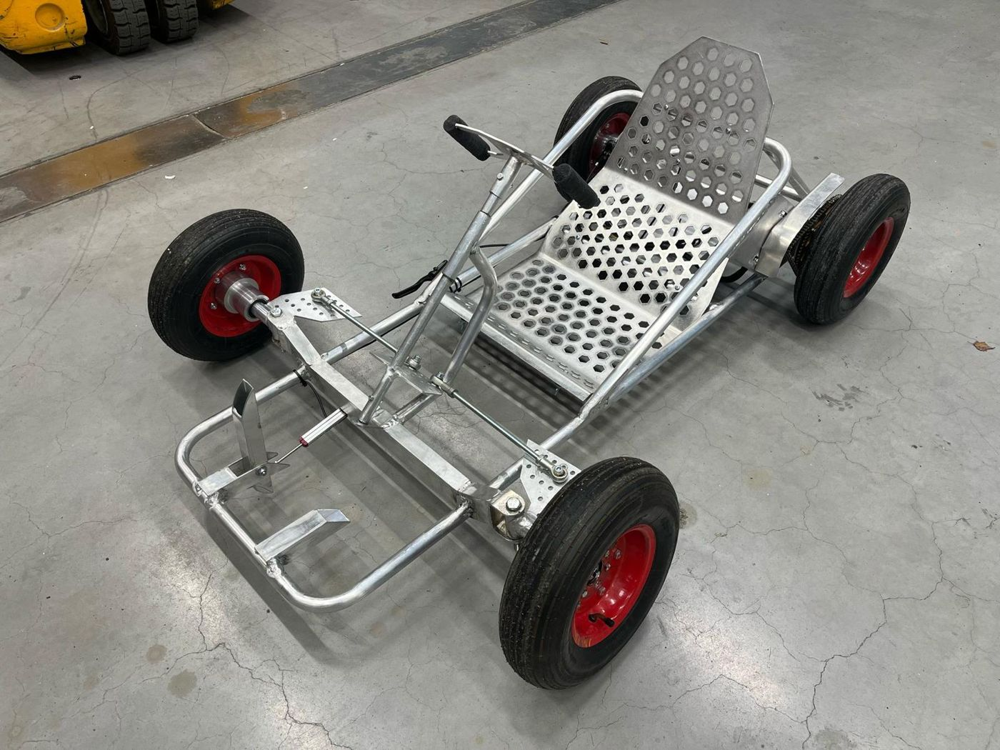
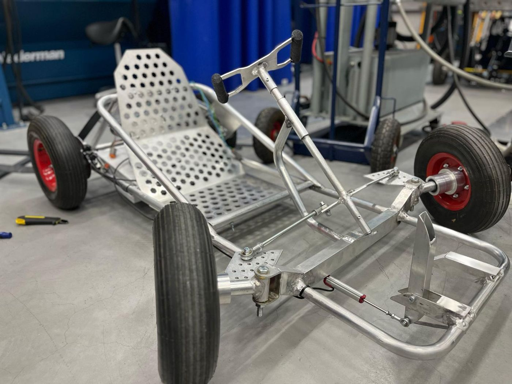
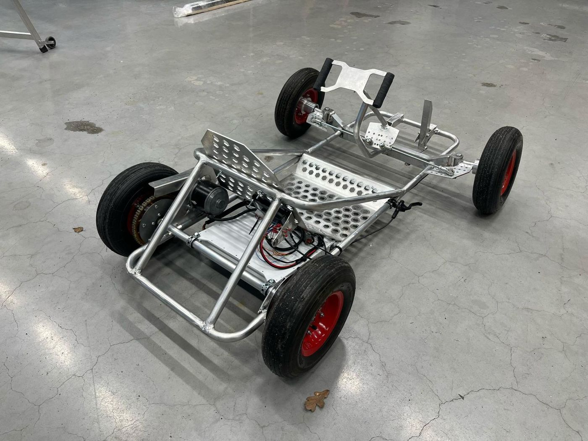
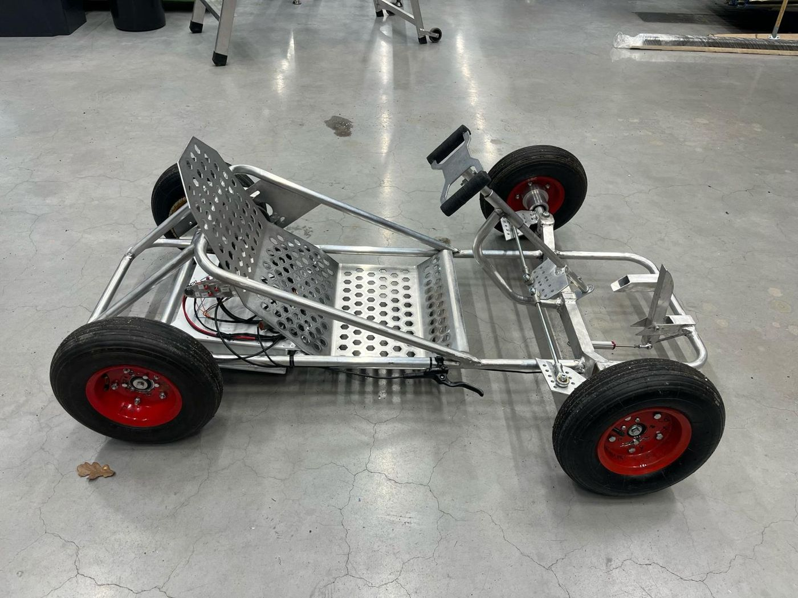
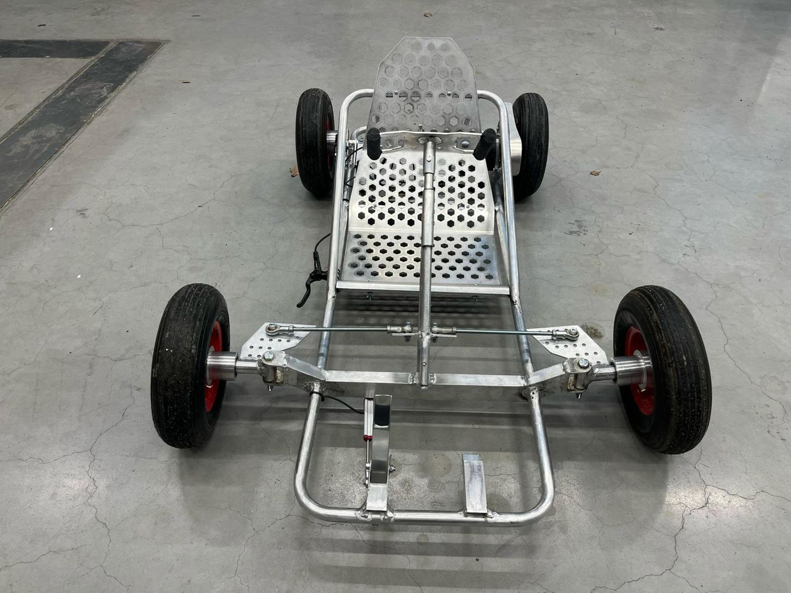
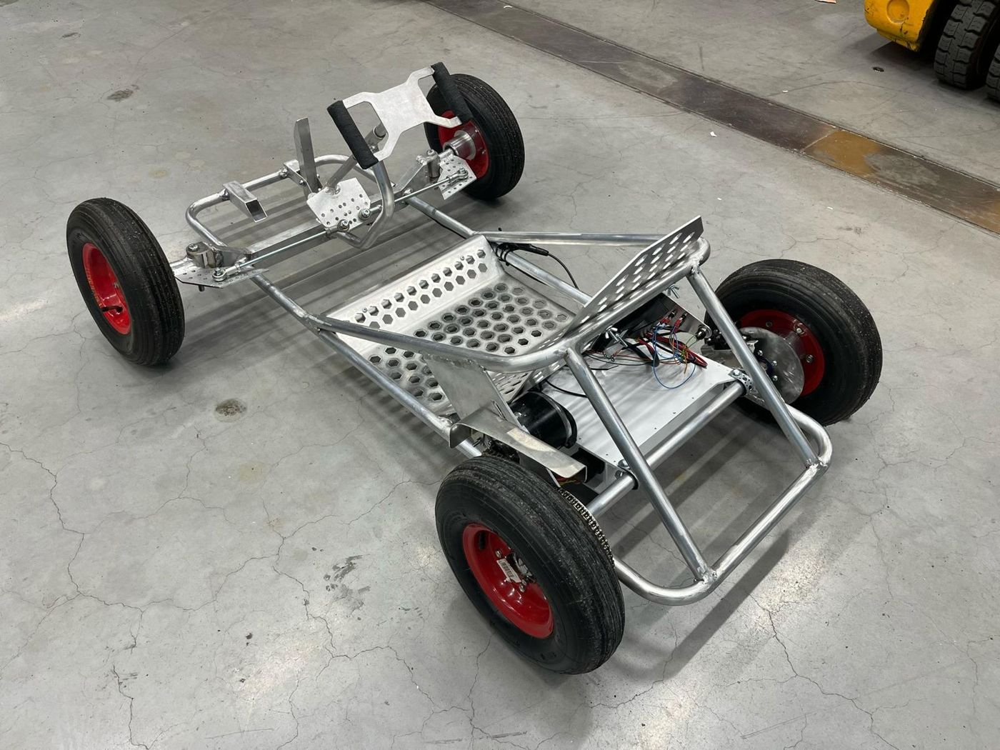
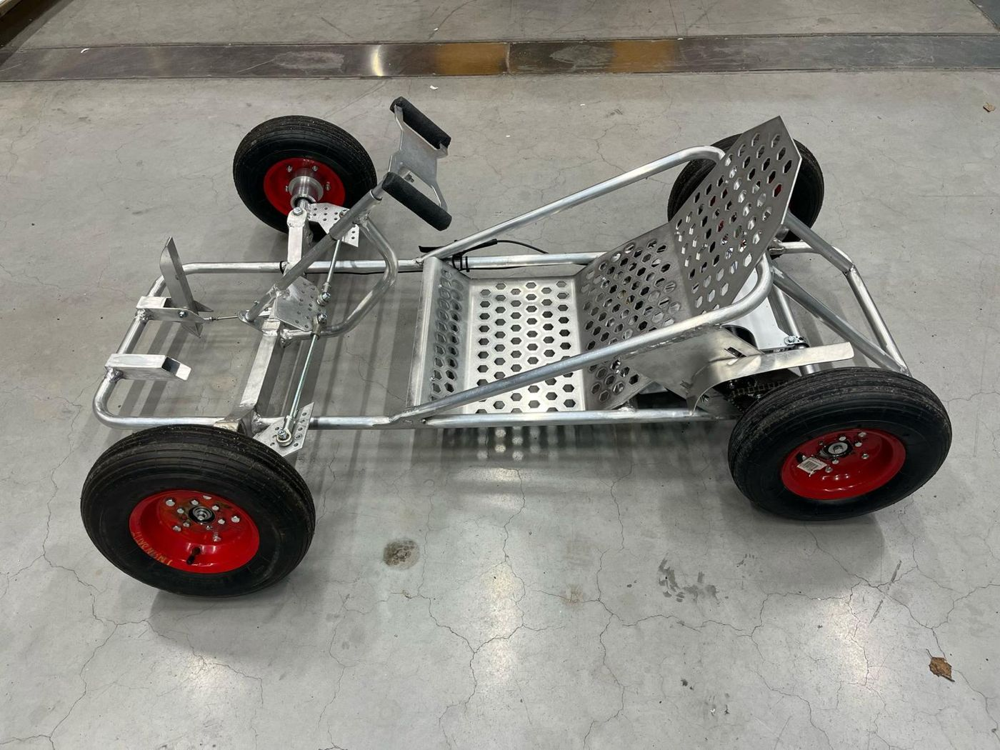
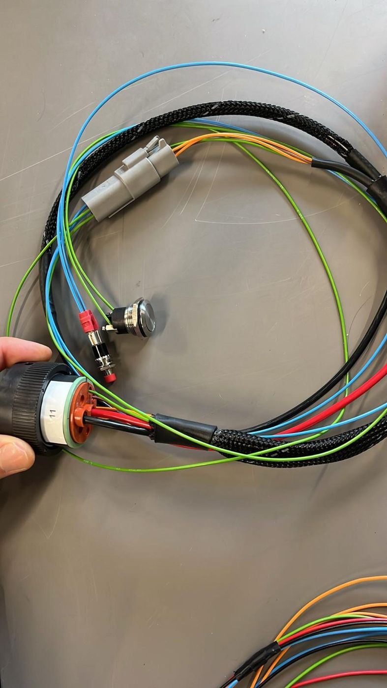

# Electric Go-Kart

An electric go-kart with a welded aluminium frame, built from scratch as a school team project.

---

## My part

- **Electrical system:** all battery connections and the wire harnesses
- **ECU tuning:** set up and tuned the motor controller for the electric drive
- **Machining:** turned the wheel hubs on the lathe
- **Design and assembly:** designed some of the parts and helped assemble the kart with the team

## Build

| | |
|---|---|
| Frame | Aluminium tube frame with perforated aluminium seat and floor plates |
| Drive | Electric motor with chain drive to the rear axle |
| Steering | Tie-rod steering with machined hubs |
| Controls | Throttle and brake pedals, hand brake lever |

## Gallery

| | |
|---|---|
|  |  |
|  |  |
|  |  |

### Wire harness

## Skills

Mechanical engineering · Electrical installation · Wire harness building · ECU tuning · Lathe machining · Teamwork

## Author

Edvárd Nagy, with the school project team · [Portfolio](https://edvardna.github.io)
